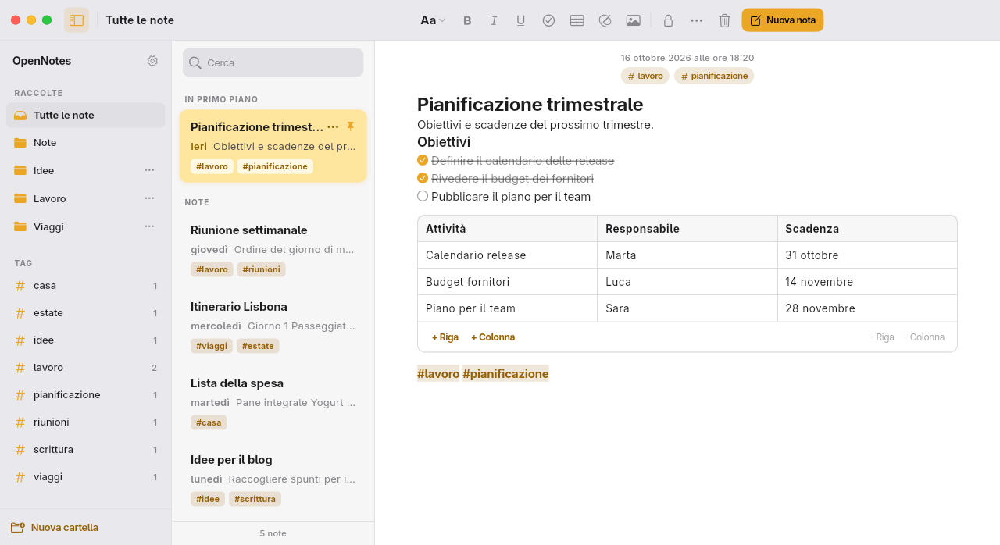

  

# OpenNotes

A local-first notes app inspired by Apple Notes, for desktop and mobile.

 

## Screenshots

## Features

- Live-formatting editor with Markdown shortcuts: headings, lists, checklists, quotes, tables, images and freehand drawings.
- Folders, tags written in the text, search, pinned notes, and a trash with undo and restore.
- Notes locked with a PIN.
- Works offline and keeps a copy of every note in a vault folder on the device.
- Share or save a note as Markdown.
- Interface that adapts from desktop to mobile, with light and dark themes that follow the system.
- Optional cloud sync with Google sign-in, see [Cloud sync (experimental)](#cloud-sync-experimental).

## Download

Get the latest build from the [Releases](https://github.com/nicchia-code/OpenNotes/releases) page:

- Windows: `.zip`
- macOS: `.dmg`
- Linux: `.AppImage`

For Android and iOS, see [Build from source](#build-from-source).

## Cloud sync (experimental)

The app works fully without signing in. In Releases, signing in with Google syncs your notes with the Supabase project run by the maintainer. This feature is experimental: do not use it for sensitive data.

## Known limitations

- Locked notes are not encrypted: the PIN only hides the content in the app, which stays in plain text on the device and in the cloud.
- Packages: no ready-made build for Android and iOS. The macOS `.dmg` has only an ad-hoc signature and is not notarized, so you must get past the Gatekeeper warning to open it. The Windows `.zip` is not signed. The AppImage requires GTK 3 installed on the system.

## Build from source

Prerequisites:

- [FVM](https://fvm.app), with the Flutter version set in `.fvmrc`.
- On Linux, the system packages used by CI: `clang`, `cmake`, `ninja-build`, `pkg-config`, `libgtk-3-dev`, `liblzma-dev`, `libstdc++-12-dev`.

Run the app:

- Copy `.env.example` to `.env` and fill in the values.
- Start the app with `fvm flutter run --dart-define-from-file=.env`.

Without the values the app works only locally and shows the cloud-not-configured notice.

## Set up your own Supabase

- Create a Supabase project and run `supabase/schema.sql` in it.
- Enable the Google provider and add `http://localhost:3000` and `opennotes://login-callback` to the redirect URLs.
- Put the project URL and anon key in `.env`.

## License

MIT. See [LICENSE](LICENSE).
